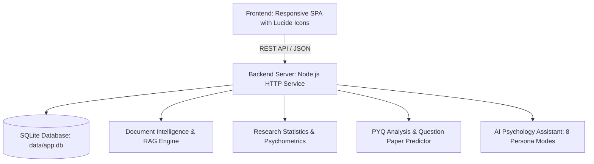

# Personal Psychology Knowledge & Intelligence Platform

A comprehensive, evidence-grounded, single-user digital psychology library, academic research workspace, clinical reference centre, and intelligent examination preparation platform.

---

## 1. System Vision & Architecture

The application is built strictly for single-user academic and clinical workflow:
- **No authentication / No login or registration forms**: Immediate access to personal library and tools.
- **Zero-Dependency Lightweight Backend**: Built on Node.js using standard library modules and native high-speed `node:sqlite`.
- **Relational Data Persistence**: SQLite database stored locally at `data/app.db` with WAL mode and indexing.
- **Modular Single-Page Application**: Responsive interface with Inter typography, Lucide icons, deep purple and soft lavender palette, light/dark theme switching, and split-screen document intelligence reader.



---

## 2. Main Navigation Modules

1. **Dashboard**: Global psychology search, study progress bar, recent uploads, diagnostic shortcuts, and quick actions.
2. **Psychology Digital Library**: 8 core categories (General, Clinical, Counselling, Assessment, Diagnostic, Research, Educational/Applied, Academic) with verification badges and APA 7th / BibTeX citation metadata.
3. **Psychology Knowledge Base**: Structured knowledge articles featuring the **17 standard academic dimensions** (Definition, Theorists, Models, Research Evidence, Applications, Dedicated References) and concept relationship graph.
4. **Clinical Psychology Reference Centre**: 14 clinical domains including Mental Status Examination (MSE) protocols, Biopsychosocial Case Formulation (5 P's model), differential diagnosis, and clinical documentation templates with 1-click clipboard copy.
5. **Diagnostic & Assessment Centre**: Standardized test catalogue (Intelligence, Personality, Neuropsychological, Clinical Screening) with verified reliability/validity metrics, qualification tiers (Level C/B), and an interactive **Side-by-Side Instrument Comparison Matrix**.
6. **Document Intelligence (Split-Screen RAG)**: Upload PDF, DOCX, TXT, CSV, PPTX, or scanned notes with OCR fallback; page-preserving viewer on the left, grounded AI workspace on the right, text selection questioning ("Ask AI about selection"), and multi-document comparative synthesis with exact page citations.
7. **Research Hub**: Hypothesis formalization, sample size guidelines, statistical calculators (Descriptive, Independent t-test, Pearson correlation, Cronbach's Alpha), and multi-format citation export (APA 7th, MLA 9th, Chicago, Vancouver, BibTeX, RIS).
8. **PYQ & Exam Preparation**: Syllabus-aligned question bank (UGC NET Paper II, entrance exams), unit-wise distribution, multi-year frequency trends, and automatic question extractor.
9. **Question Paper Predictor**: Historical pattern predictor combining multi-year recurrence, syllabus unit weightages, theorist prevalence, and rotational latency into predicted practice papers with confidence tiers (*High historical relevance*, *Moderate*, *Exploratory*).
10. **Teaching Workspace**: Lesson plans with Bloom's taxonomy objectives, classroom activities, formative assessment questions, and 1-click Markdown export.
11. **Notes & Bookmarks**: Saved references and persistent scholar revision scratchpad.
12. **AI Psychology Assistant**: Centralized assistant with 8 specialized persona modes and strict source prioritization.
13. **Settings**: Scholar profile preferences, target examination selection, citation defaults, and visual theme toggle.

---

## 3. Quick Start & Execution

### Starting the Application:
Simply double-click `start.bat` or run in PowerShell:
```powershell
& "C:\Users\sabuj\AppData\Local\ms-playwright-go\1.57.0\node.exe" server/server.js
```
The application will launch on:
```
http://localhost:3000
```

### Running the Comprehensive Test Suite:
```powershell
& "C:\Users\sabuj\AppData\Local\ms-playwright-go\1.57.0\node.exe" test/verify.js
& "C:\Users\sabuj\AppData\Local\ms-playwright-go\1.57.0\node.exe" test/apiTest.js
```

---

## 4. Key Design Principles & Verification

- **Never Fabricate References**: Citations in the foundational knowledge base, diagnostic catalogue, and clinical reference centre cite authentic works (e.g., DSM-5-TR, ICD-11, Baddeley 2000, Wechsler 2008, Beck 1979/1996, Ben-Porath 2020).
- **Page-Level Grounded Citations**: When querying uploaded documents, every response provides the exact document title, page number, section heading, and supporting excerpt.
- **Predictive Transparency**: Predicted questions explicitly explain their historical derivation and display methodological notices stating that historical frequency does not guarantee future inclusion.
- **Copyright & Licensing Compliance**: Proprietary test items, answer keys, and protected normative tables are not reproduced.

